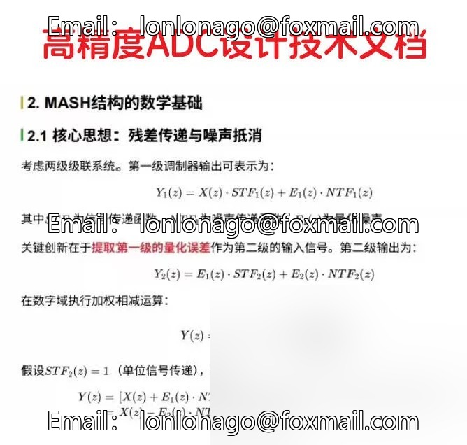

# High-precision ADC design technical document, high-precision sigma delta AD

## Body

High-precision ADC design technical document; high-precision sigma delta ADC design technical document

Content:
1. Understanding and design of mash structure (including references), understanding and design of VCO_base mash structure
2. Analysis and compensation of continuous-time SD ADC
3. Analysis of noise shaping SAR and zoom ADC
4. Chopper technology and verification (including simulation guidance)
5. Analysis and comparison of CIFB and CIFF architecture, introduction of some feedforward CIFF architecture
6. Analysis of the impact of high-precision reference sources on ADC performance

Suitable for reading by IC design engineers, all are the accumulation of their many years of design experience, and possess multiple experiences of precision high-accuracy ADC lithography.

web-based shipment, can be directly photographed and shipped.

The document covers high-precision ADC design technology, including the MASH structure, continuous-time SD ADC analysis, noise shaping SAR and Zoom ADC, chopping technology validation, CIFB and CIFF architecture analysis and comparison, and impact analysis of high-precision reference sources on ADC performance.

<!-- AI_ENRICHED -->

## Images

## Payment

Here is a pay link on Stripe ( https://buy.stripe.com/3cs8yP7sY87d0vu9AB ). Please contact me lonlonago@foxmail.com after funding $89, and I will send you a complete data files , thank you!

